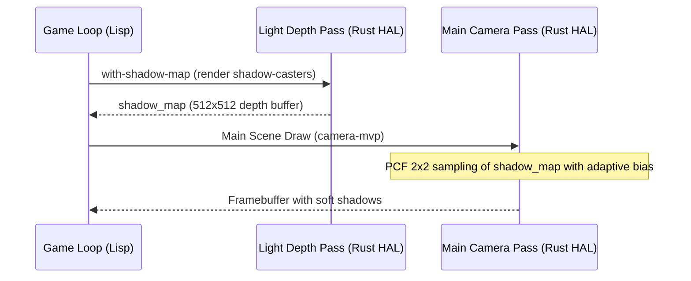

# Освещение и тени: Shadow Mapping & Point Lights (Этап 4)

В rlisp-engine реализована система динамического освещения и теней, расширяющая фиксированный конвейер растрового 3D-рендерера (Level 1 HAL) и 3D DSL (Level 3 Lisp).

---

## 1. Точечные источники света (Point Lights)

Поддерживается произвольное количество динамических точечных источников света (фонари, снаряды, плазма, факелы).

### Физическая модель
- **Затухание (Attenuation)**: квадратичное затухание с плавной отсечкой по радиусу:
  $$\text{att} = \frac{\max\left(0, 1 - \frac{d}{R}\right)}{1.0 + 0.09 \cdot d + 0.032 \cdot d^2} \cdot \text{attenuation}$$
- **Диффузный вклад**: $I_{\text{diff}} = \text{color} \cdot \text{att} \cdot \max(0, N \cdot L)$.
- **Зеркальный блик (Blinn-Phong)**: $I_{\text{spec}} = \text{color} \cdot \text{att} \cdot \text{strength} \cdot \max(0, N \cdot H)^{\text{shininess}}$.
- Работает как в непрозрачном проходе (`raster_tris`), так и в прозрачном проходе с сортировкой (`blend_tri`).

### Lisp API
```lisp
;; Добавление точечного источника света
(add-point-light x y z r g b radius [attenuation])
(gpu3d-add-light 'point x y z r g b radius [attenuation])

;; Очистка всех точечных источников (в начале кадра)
(clear-point-lights)
(gpu3d-clear-lights)
```

---

## 2. Карты теней (Shadow Mapping)

Для реализации жестких и мягких теней от направленного источника света (солнца) используется двухпроходный алгоритм Shadow Mapping с фильтрацией PCF 2×2.



### Двухпроходный конвейер
1. **Light Depth Pass (Shadow Pass)**:
   - Активируется через `(with-shadow-map light-matrix ...)` или `(gpu3d-shadow-begin light-matrix [w [h [bias]]])`.
   - Включает режим `shadow_pass = true`: геометрия проецируется матрицей света в буфер `shadow_map` (по умолчанию 512×512).
   - Выполняется легковесная растеризация только глубины (без UV, нормалей, текстур, цвета и освещения), что минимизирует нагрузку на CPU.
   - Завершается вызовом `(gpu3d-shadow-end)`.

2. **Main Camera Pass**:
   - При основном рендере мировая позиция каждого пикселя $(w_x, w_y, w_z)$ переводится в систему координат источника света:
     $$[l_x, l_y, l_z, l_w]^T = \text{light\_matrix} \cdot [w_x, w_y, w_z, 1.0]^T$$
   - Вычисляются координаты в теневой карте и глубина $s_z$.
   - **PCF 2×2 (Percentage Closer Filtering)**: берутся 4 соседних текселя теневой карты вокруг точки семплирования, проверяется условие $s_z - \text{bias} \le \text{depth}$, и результат билинейно интерполируется в диапазоне $[0.0, 1.0]$.
   - Прямой солнечный свет (`diffuse` и `specular`) умножается на коэффициент тени, а `ambient` и точечные источники света остаются активными даже в тени.

### Lisp API
```lisp
;; Ортографическая проекция
(mat-ortho left right bottom top near far)

;; Расчёт матрицы вида-проекции солнца
(light-camera-matrix light-dir target size near far)

;; Отрисовка кастеров тени
(with-shadow-map light-mat
  (draw-batch *mesh-pillar* *pillar-insts* light-mat)
  (draw-batch-tex *mesh-cube* *uv-cube* *tex-panel* (enemy-insts t) light-mat))
```

---

## 3. Тестирование

Реализован модульный тест `render3d::tests::shadow_and_point_lights`:
1. Проверка аналитического затухания света лампы и строгого обнуления за пределами `radius`.
2. Проверка записи кастера в теневую карту.
3. Проверка семплирования: коэффициент 0.0 строго под кастером, 1.0 на открытом участке и плавный переход на границе (PCF).

Запуск тестов:
```powershell
cargo test --workspace -j 1 -- render3d::tests::shadow_and_point_lights
```
