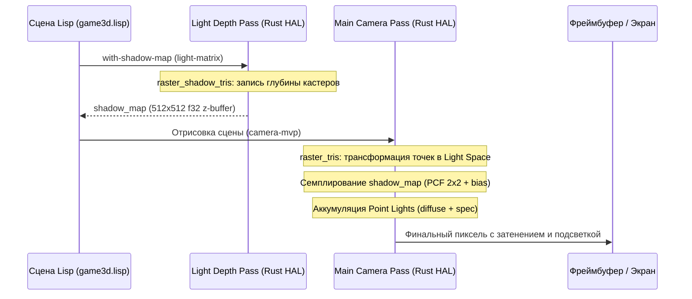

# Освещение и тени (Shadow Mapping & Point Lights)

Руководство для мейнтейнера и архитектурный обзор подсистемы динамического освещения и карт теней `rlisp-engine`.

Документ описывает математику, алгоритмы растеризатора, двухпроходный конвейер теневых карт, структуру точечных источников света и Lisp DSL в рамках фиксированного конвейера Level 1 HAL и Level 3 Lisp.

---

## 1. Архитектурный контекст и цели

До реализации этапа 4 в движке поддерживался исключительно **один глобальный направленный свет** (солнце) без отбрасывания теней:
- Под объектами отсутствовали тени: земля под скалами, деревьями и пилонами освещалась так же ярко, как открытые участки;
- Объекты казались «висящими в воздухе», отсутствовал контактный объем с плоскостью арены;
- Не поддерживались локальные источники света: факелы, летящие снаряды, плазменные вспышки и неоновые лампы не влияли на геометрию вокруг себя.

### Архитектурные принципы решения
1. **Разделение уровней (Zero-Core Hardcoding)**:
   - **Level 1 (Rust HAL)** знает только примитивы: геометрия, глубина, буфер теневой карты и массив точечных источников. Rust ничего не знает про игру, пилоны или снаряды;
   - **Level 3 (Lisp DSL)** управляет матрицами источника света (`light-camera-matrix`, `mat-ortho`), макросом `with-shadow-map`, жизненным циклом ламп и сценой.
2. **CPU Performance Guard**:
   - Depth-only предварительный проход (`raster_shadow_tris`): кастеры тени рисуются без текстурирования, без расчета нормалей, без UV-интерполяции и без блендинга;
   - Разделение на **кастеры** (`shadow-casters`: пилоны, враги) и **приемники** (`shadow-receivers`: пол, вода). Пол никогда не рендерится в теневую карту;
   - PCF 2×2 вычисляется по аналитическим субпиксельным координатам за 4 выборки из плоского вектора глубины.

---

## 2. Архитектура конвейера и структуры данных



### 2.1. Структуры данных Rust (`src/render3d.rs`)

```rust
/// Точечный источник света
#[derive(Clone, Debug, PartialEq)]
pub struct PointLight {
    pub pos: [f32; 3],       // Мировые координаты (x, y, z)
    pub color: [f32; 3],     // Интенсивность/цвет (r, g, b)
    pub radius: f32,         // Радиус действия (свыше — строгая отсечка)
    pub attenuation: f32,    // Множитель затухания (по умолчанию 1.0)
}

pub struct R3 {
    // ... прежние поля: zbuf, light, ambient, diffuse, spec, shininess, view ...
    
    /// Активные точечные источники света в кадре
    pub point_lights: Vec<PointLight>,
    /// Буфер теневой карты (depth buffer с точки зрения солнца)
    pub shadow_map: Vec<f32>,
    pub shadow_w: usize,
    pub shadow_h: usize,
    /// Матрица вида-проекции солнца (Light View-Projection Matrix)
    pub light_matrix: [f32; 16],
    /// Флаг режима записи теневой карты (depth-only)
    pub shadow_pass: bool,
    /// Флаг активности теней при основном рендере
    pub shadow_enabled: bool,
    /// Смещение глубины для устранения shadow acne (по умолчанию 0.005)
    pub shadow_bias: f32,
}
```

---

## 3. Математическая модель

### 3.1. Точечные источники света (Point Lights)

Для каждого пикселя с мировой позицией $W = (w_x, w_y, w_z)$ и нормалью $N$:
1. Вектор направления к источнику:
   $$L = \text{LightPos} - W, \quad d = \|L\|$$
2. Отсечка по радиусу: если $d \ge R$ или $d < 10^{-6}$, источник света не дает вклада.
3. Физическое квадратичное затухание с плавным спадом к границе сферы:
   $$\text{att} = \frac{\max\left(0, 1 - \frac{d}{R}\right)}{1.0 + 0.09 \cdot d + 0.032 \cdot d^2} \cdot \text{attenuation}$$
4. Диффузная составляющая (Lambert):
   $$\hat{L} = \frac{L}{d}, \quad I_{\text{diff}} = \text{LightColor} \cdot \text{att} \cdot \max(0, N \cdot \hat{L})$$
   *(В прозрачном двустороннем проходе: $|N \cdot \hat{L}|$)*.
5. Зеркальный блик Blinn-Phong:
   $$\hat{V} = \frac{\text{CameraPos} - W}{\|\text{CameraPos} - W\|}, \quad \hat{H} = \frac{\hat{L} + \hat{V}}{\|\hat{L} + \hat{V}\|}$$
   $$I_{\text{spec}} = \text{LightColor} \cdot \text{att} \cdot \text{spec\_strength} \cdot \max(0, N \cdot \hat{H})^{\text{shininess}}$$

---

### 3.2. Карты теней (Shadow Mapping)

#### А. Проход записи глубины (Shadow Pass)
В режиме `r3.shadow_pass == true`:
- При вызовах `gpu3d-mesh`, `gpu3d-mesh-tex`, `gpu3d-batch` вершины преобразуются в клип-пространство источника света:
  $$C_{\text{light}} = \text{light\_matrix} \cdot \text{model} \cdot P$$
- Выполняется Sutherland–Hodgman клиппинг по ближней плоскости $z + w \ge 0$;
- Вершины проецируются на вьюпорт $W_{\text{shadow}} \times H_{\text{shadow}}$ (дефолт 512×512):
  $$s_x = (n_x \cdot 0.5 + 0.5) \cdot W_{\text{shadow}}, \quad s_y = (1.0 - (n_y \cdot 0.5 + 0.5)) \cdot H_{\text{shadow}}, \quad s_z = n_z$$
- Двусторонняя растеризация треугольников: пишется только минимальная глубина $s_z$ в `r3.shadow_map[y * W + x]`.

#### Б. Семплирование и фильтрация PCF 2×2 (Main Pass)
В основном проходе для каждого фрагмента известна его мировая позиция $(w_x, w_y, w_z)$:
1. Перевод в координаты источника света:
   $$[l_x, l_y, l_z, l_w]^T = \text{light\_matrix} \cdot [w_x, w_y, w_z, 1.0]^T$$
2. Если точка выходит за пределы конуса света ($n_x, n_y, n_z \notin [-1, 1]$), она считается освещенной ($S = 1.0$).
3. Непрерывные координаты в теневой карте:
   $$s_x = (n_x \cdot 0.5 + 0.5) \cdot (W_{\text{shadow}} - 1), \quad s_y = (1.0 - (n_y \cdot 0.5 + 0.5)) \cdot (H_{\text{shadow}} - 1)$$
4. Субпиксельные доли: $f_x = s_x - \lfloor s_x \rfloor$, $f_y = s_y - \lfloor s_y \rfloor$.
5. Четыре выборки с проверкой смещения глубины (`bias`):
   $$\text{test}(x, y) = \begin{cases} 0.0, & \text{если } s_z - \text{bias} > \text{shadow\_map}[y, x] \quad (\text{в тени}) \\ 1.0, & \text{иначе} \quad (\text{на свету}) \end{cases}$$
6. Билинейная интерполяция результатов:
   $$S = \text{lerp}(\text{lerp}(s_{00}, s_{10}, f_x), \text{lerp}(s_{01}, s_{11}, f_x), f_y)$$

#### В. Итоговая композиция освещения пикселя
$$C_{\text{final}} = \text{Albedo} \cdot \left(\text{ambient} + \text{diffuse} \cdot \max(0, N \cdot L_{\text{sun}}) \cdot S + I_{\text{diff, points}}\right) + \left(I_{\text{spec, sun}} \cdot S + I_{\text{spec, points}}\right)$$

Фоновый свет (`ambient`) и вклад точечных источников не зависят от теневой карты солнца, благодаря чему тени не чернеют в ноль, а сохраняют сочный естественный тон и локальную подсветку.

---

## 4. Lisp DSL API (`assets/lisp/render3d.lisp`)

| Форма Lisp | Назначение |
|---|---|
| `(mat-ortho left right bottom top near far)` | Ортографическая матрица проекции $4 \times 4$ |
| `(light-camera-matrix dir target size near far)` | Видовая матрица направленного источника света (солнца) |
| `(with-shadow-map light-mat body ...)` | Макрос двухпроходного рендеринга тени (begin → body → end) |
| `(add-point-light x y z r g b radius [att])` | Регистрация точечного источника света |
| `(clear-point-lights)` | Очистка массива точечных источников в начале кадра |
| `(gpu3d-shadow-sample x y z [bias])` | Аналитическая проверка освещенности мировой точки (0.0 .. 1.0) |
| `(gpu3d-shadow-bias [bias])` | Чтение/установка смещения глубины тени |

### Пример использования в игровом цикле
```lisp
(define (draw-scene t)
  (let* ((pxv (px 0)) (pzv (table-get *player* 'z 0.0))
         (cam-mvp (camera-mvp ...)))
    
    ;; 1. Динамические огни от пуль
    (clear-point-lights)
    (for-each
      (lambda (b)
        (add-point-light (table-get b 'x 0.0) 1.4 (table-get b 'z 0.0)
                         1.0 0.85 0.3 14.0 1.2))
      *bullets*)

    ;; 2. Теневой предварительный проход (только кастеры: пилоны и враги)
    (let* ((ldir (list 0.45 0.8 0.35))
           (lmat (light-camera-matrix ldir (list pxv 0 pzv) 55 1.0 140.0)))
      (with-shadow-map lmat
        (draw-batch *mesh-pillar* *pillar-insts* lmat)
        (draw-batch-tex *mesh-cube* *uv-cube* *tex-panel* (enemy-insts t) lmat)))

    ;; 3. Основной проход (пол принимает тени и подсветку от пуль)
    (draw-mesh-tex *mesh-floor* *uv-floor* *tex-floor* (mat-identity) cam-mvp (list 1 1 1))
    (draw-batch *mesh-pillar* *pillar-insts* cam-mvp)
    (draw-batch-tex *mesh-cube* *uv-cube* *tex-panel* (enemy-insts t) cam-mvp)))
```

---

## 5. Руководство по отладке и FAQ мейнтейнера

### Вопрос: На ровных поверхностях видна полосатая сетка («shadow acne»).
**Причина:** Погрешность округления чисел с плавающей точкой в z-буфере, когда полигон затеняет сам себя.  
**Решение:** Увеличьте смещение `bias` через `(gpu3d-shadow-bias 0.008)` (по умолчанию `0.005`).

### Вопрос: Тень «висит в воздухе» и отрывается от основания пилона («Peter Panning»).
**Причина:** Слишком большое значение `bias` смещает проекцию тени дальше фактической поверхности.  
**Решение:** Уменьшите `bias` до `0.003` или увеличьте разрешение карты теней в `gpu3d-shadow-begin`.

### Вопрос: Падает FPS при включении теней.
**Причина:** Подача тяжелых плоскостей (пола или водной глади) в теневую карту.  
**Решение:** Проверьте тело макроса `with-shadow-map`: туда должны попадать **только непрозрачные кастеры тени** (`shadow-casters`). Пол и вода являются приемниками тени (`shadow-receivers`) и должны рисоваться **только** в основном проходе.

---

## 6. Верификация и тесты

Для проверки целостности подсистемы используется юнит-тест:
```powershell
cargo test --workspace -j 1 -- render3d::tests::shadow_and_point_lights
```
Тест проверяет:
1. Затухание точечного света строго по формуле $1/(1 + 0.09d + 0.032d^2)$ и строгое равенство нулю вне `radius`;
2. Создание и очистку буфера `shadow_map`;
3. Проекцию кастера и попадание точки под кастером в тень ($S = 0.0$);
4. Открытую точку вдали от кастера ($S = 1.0$);
5. Мягкий переход фильтра PCF 2×2 на границе тени ($0 < S < 1$).
