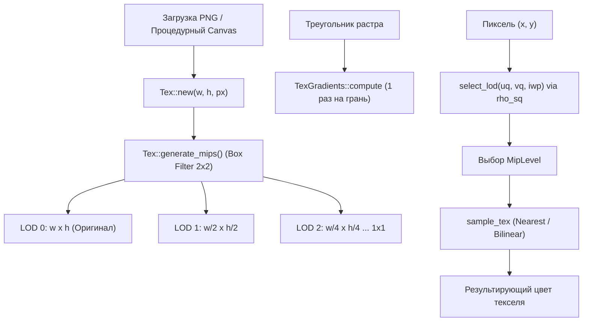

# Билинейная фильтрация текстур (Bilinear) и Mipmapping

Руководство для мейнтейнера и архитектурный обзор подсистемы текстурирования `rlisp-engine`.

Документ описывает математику, алгоритмы и Lisp-интерфейс билинейной фильтрации текстур, генерации пирамиды уровней детализации (Mipmap Pyramid) и автоматического выбора уровня детализации (LOD) по экранным градиентам в программном 3D-растеризаторе.

---

## 1. Архитектурный контекст и решаемые проблемы

До реализации данного этапа текстурный семплер движка работал исключительно в дискретном режиме `Nearest`:
$$\text{texel\_index} = \lfloor v \cdot H \rfloor \cdot W + \lfloor u \cdot W \rfloor$$

Это приводило к двум принципиальным визуальным дефектам:
1. **Текстурный алиасинг на горизонте (Texture Aliasing / Moire Shimmering):**
   При остром угле взгляда камеры к плоскости (бесконечный пол арены в `game3d.lisp`, песчаное дно или гладь воды в `island.lisp`) один экранный пиксель покрывает десятки или сотни текселей текстуры. При малейшем сдвиге камеры выбор дискретного текселя хаотично перескакивал, вызывая высокочастотное «кипение», рябь и шум на горизонте.
2. **Блочная ступенчатость вблизи (Pixel Blockiness):**
   При приближении к текстурированным объектам (кубы врагов, стены, пилоны) отдельные тексели растягивались в крупные резкие квадраты (стиль PS1/DOS).

### Цель и решение
* **Билинейная фильтрация (Bilinear Filtering):** гладкое взвешенное смешивание 4 соседних текселей по непрерывным субпиксельным координатам (стиль Nintendo 64 / 3dfx Voodoo);
* **Пирамида мипмапов (Mipmaps):** предварительно отфильтрованные уровни текстуры уменьшенного разрешения (Box Filter 2×2) вплоть до 1×1;
* **Авто-выбор LOD (Level of Detail):** динамический расчет проекции следа текселя на пиксель экрана через аналитические экранные градиенты;
* **Сохранение ретро-эстетики (Dual-Mode):** возможность переключения между `nearest` и `bilinear`, а также включения/выключения `mipmaps` как глобально, так и индивидуально в каждом материале.

---

## 2. Архитектура и структуры данных



### 2.1. Хранилище текстур (`src/hal.rs`)

Каждая текстура представлена структурой `Tex` с вектором уровней детализации `mips`:

```rust
#[derive(Clone, Debug, PartialEq, Eq)]
pub struct MipLevel {
    pub w: usize,
    pub h: usize,
    pub px: Vec<u8>,
}

#[derive(Clone, Debug)]
pub struct Tex {
    pub w: usize,
    pub h: usize,
    pub px: Vec<u8>,         // LOD 0 (RGBA8)
    pub mips: Vec<MipLevel>, // mips[0] = LOD 0, mips[1] = 1/2, ..., mips[N] = 1x1
}
```

### 2.2. Генерация пирамиды мипмапов (Box Filter 2×2)

При вызове `Tex::new(w, h, px)` или регистрации через `texture-upload` / `texture-load` запускается метод `generate_mips(&mut self)`. Каждый следующий уровень $k+1$ имеет размер:
$$W_{next} = \max(\lfloor W / 2 \rfloor, 1), \quad H_{next} = \max(\lfloor H / 2 \rfloor, 1)$$

Для каждого пикселя $(x, y)$ уровня $k+1$ усредняется блок $2 \times 2$ пикселя предыдущего уровня:
$$C_{next}(x, y) = \left\lfloor \frac{C(2x, 2y) + C(2x+1, 2y) + C(2x, 2y+1) + C(2x+1, 2y+1) + 2}{4} \right\rfloor$$
Сложение с двойкой обеспечивает математически корректное округление к ближайшему целому.

---

## 3. Математика растра: Экранные градиенты и расчет LOD

### 3.1. Аналитические градиенты рёберных функций
В сканлайн-растеризаторе треугольника положение точки задаётся барицентрическими весами $w_0, w_1, w_2$, вычисляемыми через ориентированные рёберные функции:
$$E(A, B, x, y) = (x - A_x)(B_y - A_y) - (y - A_y)(B_x - A_x)$$

Частные производные рёберной функции по экранным координатам $x$ и $y$ строго постоянны:
$$\frac{\partial E}{\partial x} = B_y - A_y, \quad \frac{\partial E}{\partial y} = A_x - B_x$$

Для треугольника с вершинами $P_0, P_1, P_2$ и суммой весов $\Sigma = w_0 + w_1 + w_2$:
$$\frac{\partial w_0}{\partial x} = P_2.y - P_1.y, \quad \frac{\partial w_0}{\partial y} = P_1.x - P_2.x$$
$$\frac{\partial w_1}{\partial x} = P_0.y - P_2.y, \quad \frac{\partial w_1}{\partial y} = P_2.x - P_0.x$$
$$\frac{\partial w_2}{\partial x} = P_1.y - P_0.y, \quad \frac{\partial w_2}{\partial y} = P_0.x - P_1.x$$

Поскольку $\Sigma$ не зависит от $(x, y)$, производные перспективо-взвешенных координат $\frac{\partial (u/w)}{\partial x}$, $\frac{\partial (v/w)}{\partial x}$, $\frac{\partial (1/w)}{\partial x}$ (и аналогично по $y$) **постоянны для всего треугольника** и вычисляются в структуре `TexGradients` ровно **один раз на грань**, до входа в пиксельный цикл.

### 3.2. Расчет частных производных UV в пикселе
В точке пикселя с известным значением $iw = 1/w$ по формуле производной частного:
$$\frac{\partial u}{\partial x} = \frac{\frac{\partial (u/w)}{\partial x} \cdot iw - (u/w) \cdot \frac{\partial (1/w)}{\partial x}}{iw^2} \cdot \text{tiling}_u$$
$$\frac{\partial v}{\partial x} = \frac{\frac{\partial (v/w)}{\partial x} \cdot iw - (v/w) \cdot \frac{\partial (1/w)}{\partial x}}{iw^2} \cdot \text{tiling}_v$$
(и аналогично $\frac{\partial u}{\partial y}, \frac{\partial v}{\partial y}$).

### 3.3. След текселя и выбор уровня LOD ($\lambda$)
Перевод градиентов в масштаб текстуры $W \times H$:
$$\rho_x^2 = \left(\frac{\partial u}{\partial x} \cdot W\right)^2 + \left(\frac{\partial v}{\partial x} \cdot H\right)^2, \quad \rho_y^2 = \left(\frac{\partial u}{\partial y} \cdot W\right)^2 + \left(\frac{\partial v}{\partial y} \cdot H\right)^2$$
$$\rho_{sq} = \max(\rho_x^2, \rho_y^2)$$

Если $\rho_{sq} \le 1.0$, пиксель экрана меньше или равен текселю (масштабирование вблизи) $\to$ выбирается **LOD 0**.
Если $\rho_{sq} > 1.0$ (удаление или острый угол):
$$\text{LOD} = \operatorname{clamp}\left( \operatorname{round}\left( 0.5 \cdot \log_2(\rho_{sq}) \right), 0, \text{mips.len}() - 1 \right)$$
*Благодаря использованию $0.5 \cdot \log_2(\rho_{sq})$ полностью исключена дорогостоящая операция квадратного корня `sqrt`.*

---

## 4. Целочисленный 16-битный билинейный семплер

Функция `sample_bilinear_raw` выполняет билинейную интерполяцию без плавающей точки в цикле каналов RGBA:
1. Вычисление непрерывных координат:
   $$u_{coord} = u \cdot (W - 1), \quad v_{coord} = v \cdot (H - 1)$$
2. Индексы 4 соседних текселей: $x_0 = \lfloor u_{coord} \rfloor$, $x_1 = \min(x_0 + 1, W - 1)$ (аналогично для $y$);
3. Дробные коэффициенты, квантованные в 8 бит:
   $$fx = \operatorname{round}((u_{coord} - x_0) \cdot 256) \in [0, 256]$$
   $$fy = \operatorname{round}((v_{coord} - y_0) \cdot 256) \in [0, 256]$$
4. Веса 4 текселей:
   * $W_{00} = (256 - fx) \cdot (256 - fy)$
   * $W_{10} = fx \cdot (256 - fy)$
   * $W_{01} = (256 - fx) \cdot fy$
   * $W_{11} = fx \cdot fy$
   * Сумма весов строго равна $256 \times 256 = 65536 = 2^{16}$.
5. Свертка каждого цветового канала:
   $$C = \left( C_{00} \cdot W_{00} + C_{10} \cdot W_{10} + C_{01} \cdot W_{01} + C_{11} \cdot W_{11} + 32768 \right) \gg 16$$
   *Максимальная сумма $255 \times 65536 + 32768 = 16\,744\,448 < 2^{32}-1$, что полностью исключает переполнение 32-битного регистра.*

---

## 5. Lisp DSL и управление состоянием конвейера

### 5.1. Настройки материалов (`assets/lisp/materials.lisp`)

```lisp
;; Определение материала с фильтрацией и мипмапами
(defmaterial 'неоновый-пол
  ':tiling '(1 1)
  ':filter 'bilinear   ;; 'nearest (дефолт) или 'bilinear
  ':mipmaps #t)        ;; #f (дефолт) или #t

;; Сброс в нейтральное ретро-состояние
(material-reset!)      ;; выставляет :filter 'nearest и :mipmaps #f
```

### 5.2. Lisp-примитивы

| Примитив | Сигнатура | Описание |
|---|---|---|
| `gpu3d-filter` | `(gpu3d-filter ['nearest \| 'bilinear])` | Получить или установить режим фильтрации текстур. |
| `gpu3d-mipmaps` | `(gpu3d-mipmaps [#t \| #f])` | Включить/выключить авто-выбор уровней пирамиды мипмапов. |
| `texture-mips` | `(texture-mips id)` | Возвращает количество доступных уровней LOD текстуры `id`. |
| `gpu3d-state` | `(gpu3d-state)` | Таблица состояния: ключи `'filter` (`'nearest`/`'bilinear`) и `'mipmaps` (`#t`/`#f`). |

---

## 6. Проверка и верификация для мейнтейнера

### 6.1. Автоматические тесты
Соблюдайте генеральный регламент ограничения потоков (`-j 1`):

```powershell
# Запуск целевого теста билинейной фильтрации и мипмапов
cargo test --workspace -j 1 -- render3d::tests::bilinear_and_mips

# Полный регрессионный прогон всех 54 тестов воркспейса
cargo test --workspace -j 1
```

Тест `bilinear_and_mips` выполняет:
1. Проверку Box Filter усреднения квадрантов при генерации пирамиды (квадратные и неквадратные текстуры);
2. Сверку точности интерполяции в точках $u = 0.0, 0.25, 0.5, 0.75, 1.0$;
3. Сравнительный растр ступенчатого `Nearest` против непрерывного плавного градиента `Bilinear`.

### 6.2. Визуальная верификация в веб-редакторе
Запуск интерактивного режима:
```powershell
cargo run --release -j 1 -- --serve --fps 60 --script assets/lisp/main3d.lisp
```
Открыть в браузере: `http://127.0.0.1:7300/`.

> [!NOTE]
> Скрипты `game3d.lisp` и `island.lisp` являются модулями игрового процесса и зависят от глобального окружения экрана и шрифтов. Точкой входа для запуска всегда является `main3d.lisp` (или `main_island.lisp`).

---

## 7. Интерактивное переключение в веб-редакторе

Для удобства отладки и визуального сравнения в верхнюю панель вида (`#viewbar` над окном 3D в [`assets/editor/index.html`](../assets/editor/index.html)) добавлены интерактивные элементы управления:

```
[ 1x ] [ 2x ] [ Fit ]  |  [ Nearest ] [ Bilinear ]  |  [ Mipmaps: Выкл/Вкл ]  |  [ ⛶ Развернуть ]
```

1. **Кнопки фильтрации (`Nearest` / `Bilinear`):**
   * Радио-кнопки с сохранением активного стиля `.vbtn.on`;
   * При клике отправляют Lisp-команду через `/api/eval`:
     ```javascript
     api("/api/eval", { code: "(gpu3d-filter 'bilinear)" });
     ```
   * Выводят всплывающее подтверждение: *«Текстуры: Bilinear (сглаживание N64/3dfx)»*.
2. **Кнопка мипмапов (`Mipmaps: Выкл / Вкл`):**
   * Тумблер с активной индикацией цвета;
   * Отправляет `(gpu3d-mipmaps #t)` или `(gpu3d-mipmaps #f)`;
   * Выводит подтверждение: *«Mipmaps: Вкл (антиалиасинг на горизонте)»*.

Ввод команд вручную в REPL больше не требуется, однако REPL по-прежнему доступен во вкладке «Консоль».

---

## 8. Интеграция с протоколом MCP (Model Context Protocol)

Все возможности подсистемы фильтрации и мипмаппинга полностью доступны подключенным ИИ-агентам и внешним инструментам через встроенный MCP-сервер движка ([`src/mcp.rs`](../src/mcp.rs)).

### 8.1. Запуск движка в режиме MCP
```powershell
cargo run --release -j 1 -- --mcp --script assets/lisp/main3d.lisp
```

### 8.2. Доступные MCP-инструменты

1. **`lisp_eval` (Управление состоянием рантайма):**
   Исполнение любого Lisp-выражения в игровой нити движка:
   ```json
   {
     "name": "lisp_eval",
     "arguments": {
       "code": "(gpu3d-filter 'bilinear)"
     }
   }
   ```
   Агент может динамически переключать режимы, настраивать материалы через `(use-material! ...)` и опрашивать состояние `(gpu3d-state)` или `(texture-mips id)`.

2. **`status` (Телеметрия движка):**
   Ответ инструмента `status` расширен полями текущего состояния текстурирования:
   ```json
   {
     "frames": 1240,
     "screen": "320x240",
     "drawcalls": 12,
     "textures": 4,
     "tex_filter": "bilinear",
     "tex_mipmaps": true
   }
   ```

3. **`screenshot` (Визуальная обратная связь):**
   Кодирует текущий фреймбуфер `hal.fb` в формат PNG (Base64). Позволяет мультимодальным моделям верифицировать устранение алиасинга на горизонте и качество сглаживания текстур.

---

## 9. Особенности аппаратного GPU-бэкенда (WGPU vs Software)

Движок поддерживает два режима вывода:
1. **Программный растеризатор (`src/render3d.rs`):**
   * Режим по умолчанию (без флага `--wgpu` или при сборке без `--features wgpu`);
   * Полностью поддерживает алгоритмы Плана 3: целочисленный 16-битный билинейный фильтр, аналитические экранные градиенты, авто-выбор LOD и пирамиду мипмапов.
2. **Аппаратный GPU-бэкенд (`--wgpu`):**
   * Требует сборки с поддержкой фичи: `cargo run --release --features wgpu -j 1 -- --wgpu ...`;
   * В аппаратном семплере (`src/gpu.rs`) фильтрация аппаратно управляется дескриптором `wgpu::SamplerDescriptor`. В текущей версии для ретро-совместимости семплер зафиксирован в `wgpu::FilterMode::Nearest`.
   * **Важно:** При запуске с `--wgpu` команды `(gpu3d-filter)` и `(gpu3d-mipmaps)` изменяют внутреннее состояние `hal.r3`, но визуальный эффект на аппаратном экране WGPU проявится только после добавления динамического переключения дескриптора семплера в `src/gpu.rs`. В программном режиме (дефолт) все фильтры и мипмапы действуют немедленно.
